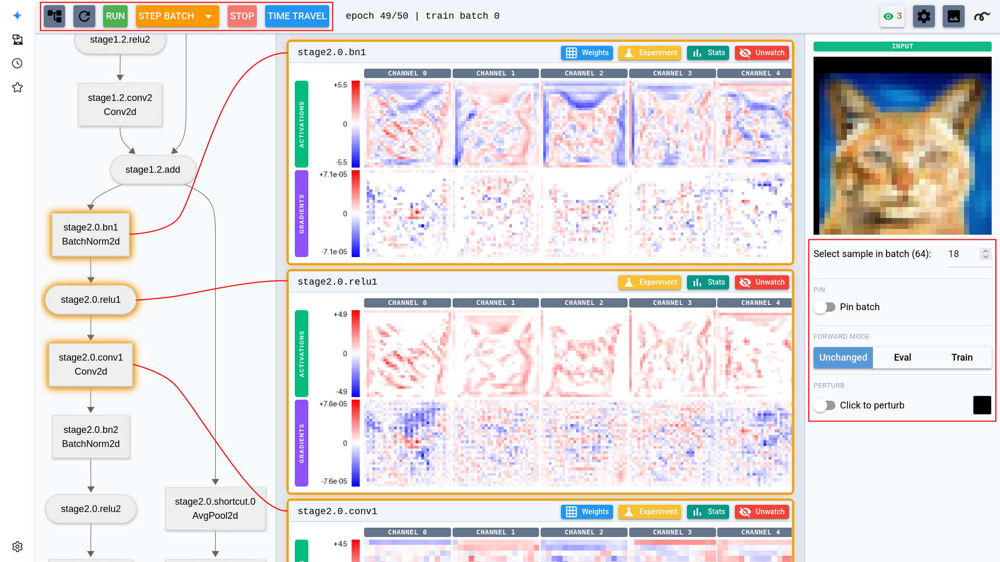

# UI guide

When a session starts, NaNsense serves a web page and pauses on the first batch.

*The main view, with training controls, the model architecture, layer cards, and the current input.*

## The top bar

You drive the run from the top bar: **Step Batch** advances one batch, **Run** runs to the end and then pauses, and **Stop** pauses a free-running session. The dropdown next to Step Batch steps a whole phase, a whole epoch, or up to a custom position.

**Time Travel** jumps back to the start of any cached epoch. It is enabled once the training loop is wrapped in a [restorer](wiring.md#time-travel), which checkpoints each epoch start to disk.

**Refresh** pulls a fresh snapshot while training free-runs, without pausing it. The settings dialog (gear icon) sets the automatic *Update frequency* — how often views refresh during Run — plus the [recording and snapshot](#recording-videos-and-snapshots) and [numerical debugging](#numerical-debugging) options.

## The main page

The left pane shows the model as a clickable architecture graph. Click a node to **watch** that layer: its activations and gradients appear as a card. Watched views refresh on every pause and, while training runs, on the *Update frequency* cadence.

Running statistics (histograms, min/max galleries, per-epoch graphs) accumulate for the watched layers only while **stats collection** is on — the stats button in the top bar, off by default. Collecting slows down training and consumes memory, so turn it on when you need the stats and watch only a few layers at a time.

Each card renders one strip per tensor: a row of per-channel images on a shared diverging blue-white-red scale. From the card you can jump to the layer's [stats view](#the-stats-page), [weights view](#the-weights-page), or [experiment page](#the-experiment-page).

The card's download button saves the layer's activation, available gradient and custom tensors from the latest captured batch as a `.pt` file — full batch, every channel, with each tensor's dtype preserved. Load it with `torch.load(path, weights_only=True)` for analysis in your own scripts. The file holds the training batch even while the page shows a pinned or perturbed input, and is limited to 256 MiB of tensor data.

## The input panel

The right sidebar chooses the input shown throughout the page. For a model with several inputs, use the **Input** menu; use **Sample** to move through the current batch. See [Displaying inputs correctly](wiring.md#displaying-inputs-correctly) for non-RGB and flat inputs.

Views follow the live training batch by default. **Pin batch** keeps the current batch visible as training advances. **Forward mode** controls whether reruns use the model's current mode, evaluation mode, or training mode.

**Perturb** lets you edit a pixel and see how the change spreads through the network. This is useful for [measuring a receptive field](showcase.md#measure-the-receptive-field-of-a-neuron).

**Render options** change how every strip on the page is drawn. **Size** sets how large every layer's tiles are shown, from thumbnails for scanning a wide layer to large tiles for reading a single feature map pixel by pixel. **Input background** draws the input image, in light gray, behind every feature map that lines up with it (convolutional maps, and transformer tokens laid back out on their patch grid): near-zero values stay white so the picture shows through, and strong responses tint it red or blue — so you can see *where* in the image a channel fires. Flat (1-D) strips are unchanged. **Average** collapses each strip's channels into a single mean image, which is how you read the *shape* of a wide layer's response without scrolling a row of sixty-four tiles. **Abs** and **Square** drop the sign first, so the strip shows magnitude on a sequential 0..max scale — squaring pulls the loudest features further out of the quiet ones. With both on, the transform happens before the mean, so channels that cancel out no longer average away to nothing. The options are per browser tab, so they work in a [shared playground](playground.md) too.

## The stats page

Open a watched layer's **stats view** for a closer look at its distributions over the epoch. The page has three views, switchable per layer:

**Histogram** leads with a statistics table per phase (activations and gradients side by side), above histograms of the layer's activation and gradient values over the epoch. A **Per channel** switch breaks the histogram down to one row per channel — the quickest way to spot [dead neurons](showcase.md#investigate-dead-neurons). A **Show subnormal/overflow** checkbox marks the dtype-aware band edges where fp16 gradients [underflow](showcase.md#spot-gradient-underflow); it is pre-checked when a numerical warning is active.

**Min/max** is a gallery of the input patches that drove each channel to its most extreme responses — see the [showcase](showcase.md#minmax-activation-patches).

**Graphs** plots per-epoch statistics (mean, std, median, min, max, plus a dead-channel count for activations) against the epoch number, one line figure for activations and one for gradients, with the legend as the stat selector. Below them, a **Weights** section adds one figure per weight tensor, sampled once per epoch — handy for watching weight drift across a whole run.

Choose **Current batch** in the Phase menu to inspect the latest capture instead of statistics collected across an epoch. This view is available for any layer.

The top bar's stats button shows the shown-layer count next to a stats icon: red and crossed out while collection is off (the default), green while every shown layer is collecting. Clicking it toggles collection without touching the cards; what was already collected stays browsable while off. If a layer's stats view has nothing to show yet, its **SHOW ME HOW** button walks through the three things stats need — a watched layer, collection on, at least one stepped batch.

The settings dialog can also switch collection between none (the default), the watched layers, or every layer. Under "every layer", showing and hiding cards on the main page is per-tab and doesn't affect what is collected.

## The weights page

Every layer with parameters has a **weights view**. Each parameter gets a panel rendering the weight tensor, its gradient, and — when the session was given an optimizer — one strip per tensor-valued optimizer-state entry (momentum buffers, Adam moments; 0-dim entries like Adam's `step` join a scalar line below), plus the parameter group's live hyperparameters such as the current learning rate.

While training is paused, edit a numeric hyperparameter such as learning rate, weight decay, momentum or epsilon, then press Enter or leave the field to apply it. The change affects the whole parameter group from the next optimizer step; the tooltip shows how many model parameters share it. An edited field stays tinted until you restore the value from before its first edit, shown in the tooltip, or time travel undoes that edit.

By default, schedulers keep adjusting the learning rate after an edit. `StepLR`, `ExponentialLR`, `CosineAnnealingLR` and `ReduceLROnPlateau` continue from your value; `LambdaLR`, `OneCycleLR` and `CyclicLR` recompute it from their own schedule and replace it at their next step. Time travel restores the checkpoint's hyperparameters, so to replay an epoch with a different learning rate, travel back first, edit, then resume training.

To scale future learning rates while keeping the schedule's shape, check **scale schedule** next to `lr` before editing it. This requires a scheduler passed to `start`. The edit sets a multiplier — new `lr` ÷ the schedule's current, unscaled `lr` — applied after every later scheduler step. A `OneCycleLR` warm-up and decay, for example, continue with all learning rates scaled by that factor.

An active multiplier appears as an amber `×factor` next to the field. Click it while paused to remove the multiplier and restore the schedule's current value, or enter that value with **scale schedule** checked. Time travel restores the multipliers in force at the checkpoint. Only `lr` is rescaled; schedulers still control any momentum or betas they cycle.

Use the axis controls to lay out convolution kernels, matrices, or embeddings. **Weight graphs** opens the layer's per-epoch history. **Download** saves the layer's parameters with available gradients, optimizer state, numeric optimizer hyperparameters and custom weight tensors as a `.pt` file. Load it with `torch.load(path, weights_only=True)`; the same 256 MiB limit on tensor data applies.

!!! note
    Weight *gradients* are read when a batch exits, so keep `optimizer.zero_grad()` at the start of your batch body — zeroing after `step()` would leave the gradient views empty (see the [Wiring guide](wiring.md#wire-it-into-your-loop-raw-pytorch)).

## The experiment page

Each layer card has an **Experiment** button. On the experiment page, pick a method — deep dream, a Captum attribution (Grad-CAM, Neuron Gradient, Neuron Integrated Gradients, Occlusion), or one of the training script's own [custom experiments](extensions.md) — set its parameters, and run it on the layer. Pause training to run an experiment manually. Attribution results show one card per input sample; custom experiments can also show tables, headline numbers, images or text.

Turn on **Live** to rerun the experiment at each capture as training advances. Runs happen on the training thread between batches.

## The tools page

When [custom tools](extensions.md#tools) are available, the main page's top bar shows a tools icon with the tooltip **Custom tools**. Open it, set a tool's arguments, and click **Run** on its card. List fields accept a JSON array or comma-separated values. Tables returned directly or as fields of a result object appear as sortable tables; remaining data appears as JSON. A tool that returns `None` shows no result output.

By default, tools run on the training thread while training is paused. If training is running, click **Stop** to let queued calls run. Tools registered with `on_training_thread=False` start on a worker thread without waiting for a pause. Locked sessions show only tools registered with `public=True`.

## Numerical debugging

Every few batches (configurable in the settings dialog), NaNsense scans activations and gradients for NaNs, infinities, and the subnormal/overflow band of the tensor's dtype. When a meaningful share of a layer's gradient magnitude lands there, training pauses with a warning banner; the dialog's per-layer rows link to the histogram view with the band edges drawn in.

## Recording videos and snapshots

The settings dialog records any view to an MP4, one frame per visualization update, written under `nansense_recordings/`. Start a recording with a layer watched or an experiment open, then save or discard it from the same dialog.

**Snapshot**, next to Record, writes that same frame just once — a PNG of the view exactly as it stands, saved to the same directory and named after the view and the training position (`main_ep3_train_b12.png`). No recording has to be running, training does not have to advance, and taking one leaves a recording of the same view alone.
